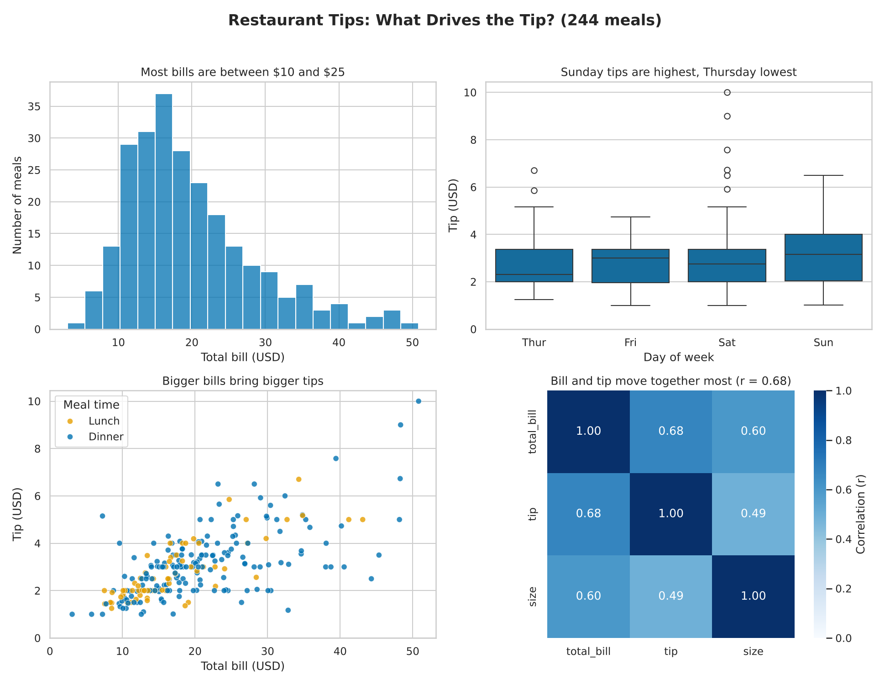
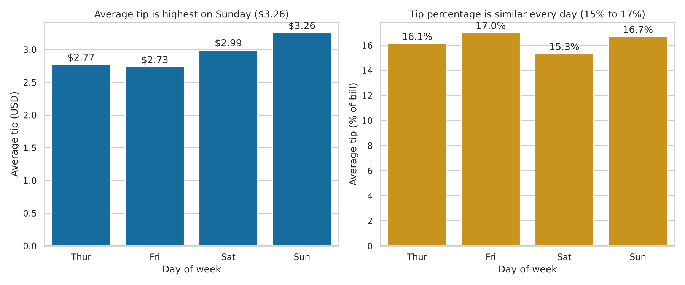

# Data Visualization with Matplotlib & Seaborn

**Project 02 | Data Science & AI | InternCircle**

Clear, honest charts built from the Seaborn **tips** dataset (244 restaurant meals), using Python, pandas, matplotlib and seaborn.

## Questions answered
1. How are restaurant bills distributed?
2. Do tips differ by day of the week?
3. Does a bigger bill mean a bigger tip?
4. Which numbers move together?

## Charts
| Question | Chart |
|---|---|
| Bill distribution | Histogram |
| Tips by day | Box plot and bar charts |
| Bill vs tip | Scatter plot |
| What moves together | Correlation heatmap |





## Key findings
- About 71% of bills are between $10 and $25 (median about $18).
- Sunday has the highest median tip ($3.15) and Thursday the lowest ($2.30), but tip percentage is about the same every day (15% to 17%).
- Bigger bills bring bigger tips (r = 0.68), the strongest relationship in the heatmap.

## Design choices
- One colour-blind-friendly palette (blue and orange, no red and green together)
- Bar charts start at zero
- Titles state the finding; every axis has a label and units
- No 3D or pie charts

## Limitations
The dataset is small (Friday has only 19 meals). Correlation does not prove cause.

## Files
- `Tips_Data_Visualization.ipynb`: the full notebook
- `Tips_Data_Visualization.html`: the notebook as a web page
- `tips_overview.png`: 2 x 2 dashboard (150 dpi)
- `tips_bar_charts.png`: bar charts by day

## Run it yourself
```
pip install jupyter pandas numpy matplotlib seaborn
jupyter notebook Tips_Data_Visualization.ipynb
```
Or upload the notebook to Google Colab and choose Runtime > Run all.

**Author:** Your Name
